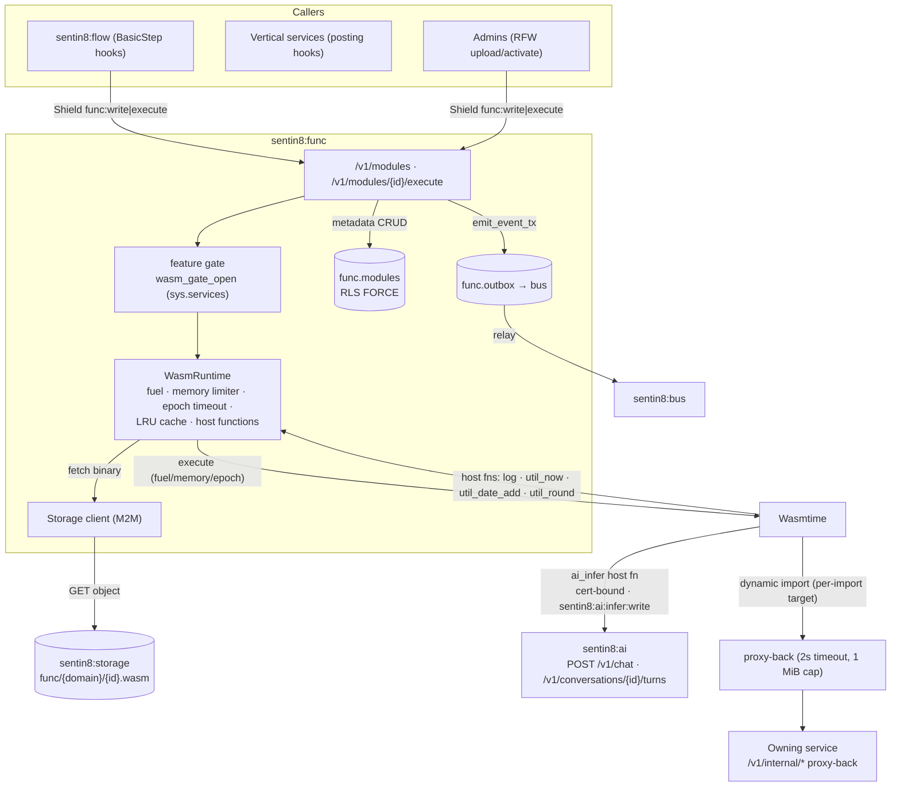
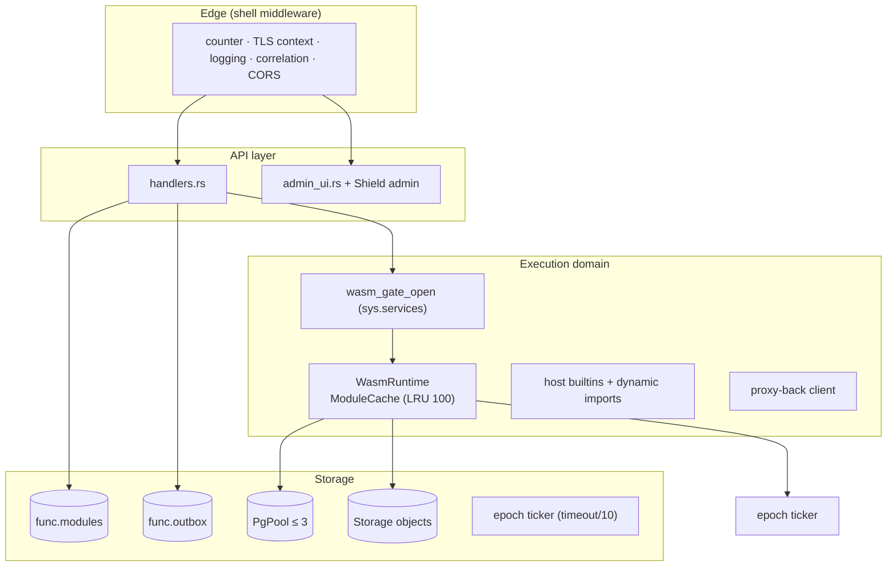
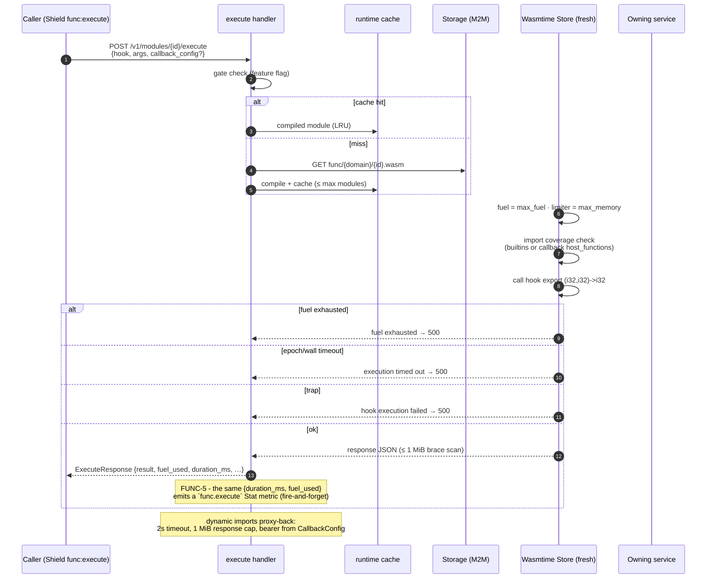
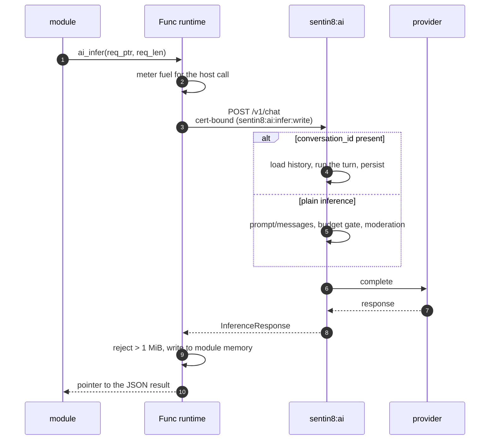
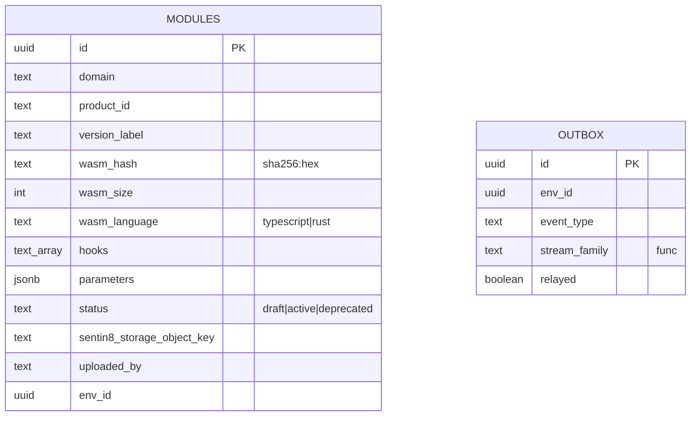
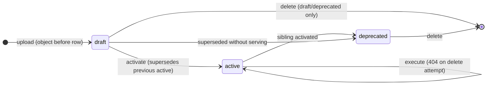
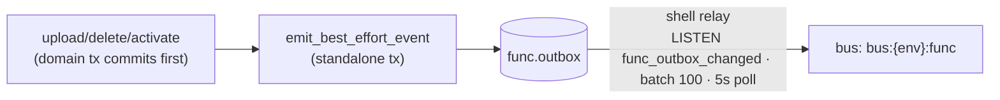
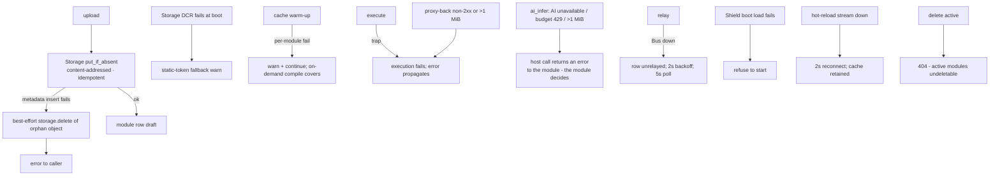
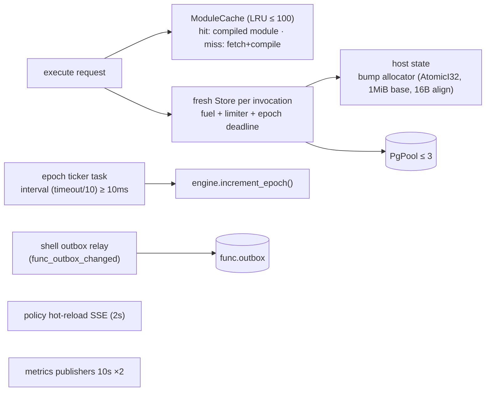
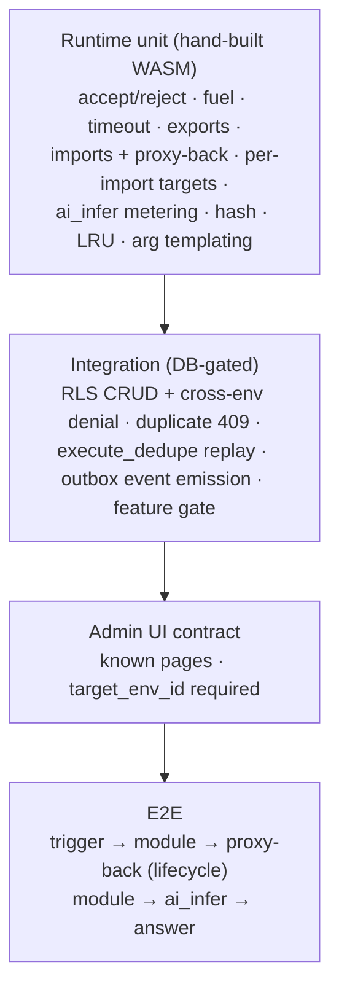

# Sentin8:Func - Detailed Design Document

## 1. Scope & Context

Sentin8:Func is the platform's standalone WASM execution service:
user-authored and service-authored modules are uploaded to Storage,
validated (imports/hooks), activated per (domain, product, environment),
and executed per hook under hard resource bounds - fuel, memory limiter,
epoch/wall-clock timeout, 1 MiB response caps - with host functions
proxy-calling back to owning services for domain data **and to
Sentin8:AI for model inference**.

- **Owns** (schema `func`): `modules` (metadata + lifecycle +
  content-addressed Storage key), `outbox` (DBX producer), and
  `audit_journal`. Module binaries live in Sentin8:Storage
  (`func/{domain}/{id}.wasm`, content-addressed by sha256).
- **Does NOT own**: the WASM source/toolchain (uploads are compiled
  binaries), the hooks' business semantics (proxy-back to the owner),
  conversation state (Sentin8:AI holds every transcript - a module
  addresses a conversation by id), and trigger registration (declared
  empty - execution is API-triggered, e.g. by Flow's `BasicStep` or
directly by an agent tool of kind `func_module`).



Trust boundary: a module can never escape the sandbox - linear memory
only, no WASI, imports restricted to the builtin namespace or
declared host-function targets, and every host call goes to an explicit
target the execution request declared. The default is **one destination**
(the registering service's internal API); additional destinations
(Sentin8:AI, or another owner) must be named per import by the caller,
which keeps the import-coverage check a genuine allowlist.

The two inference paths available to a module are deliberately distinct:

| Path | Identity | Shape |
|---|---|---|
| `ai_infer` builtin | the module's workload certificate + `sentin8:ai:infer:write` | first-class host function; may carry `conversation_id` for multi-turn |
| `host_functions` entry pointing at `/v1/chat` | the caller's bearer in `callback_config` | generic proxy-back; the caller owns the scope decision |

## 2. Runtime Architecture

| Module | Role |
|---|---|
| `runtime.rs` | Wasmtime engine: fresh `Store` per invocation, fuel accounting, `ResourceLimiter` (memory), epoch deadline + ticker, LRU module cache, host builtins (`malloc`, `free`, `log`, `util_now`, `util_date_add`, `util_round`, `ai_infer`), per-import proxy-back targets, `substitute_args` templating. |
| `handlers.rs` | Upload (Storage `put_if_absent` before row), list/get/delete/activate/validate/execute, feature gate, event emission, health. |
| `store.rs` | Module metadata CRUD - every op = explicit tx + `set_rls` on the same connection; duplicate checks + unique indexes. |
| `admin_ui.rs` | RFW overview/versions pages + data endpoints (`target_env_id` required). |
| `server.rs` / `config.rs` / `registration.rs` | State (runtime + Storage M2M client + cache warm-up), routes, self-description. |



**Execution lifecycle:**



**Host-function target contract (`CallbackConfig`):**

A `host_functions` entry accepts two shapes. The bare-string shorthand
keeps the original one-destination behaviour and needs no module changes:

```jsonc
{
  "base_url": "https://ledger.ops.sys.{domain}",
  "internal_path": "/v1/internal",
  "auth_token": "<caller bearer>",      // or omitted on the cert path
  "host_functions": {
    // shorthand: {base_url}{internal_path}{path}, GET
    "ledger_balance": "/accounts/{args.0}/balance",
    // explicit target: any owner, any method
    "ledger_post": { "url": "https://ledger.ops.sys.{domain}",
                     "path": "/v1/internal/postings",
                     "method": "POST" },
    // AI inference through the generic path (caller owns the scope)
    "ai_chat":    { "url": "https://ai.ops.sys.{domain}",
                    "path": "/v1/chat", "method": "POST" }
  }
}
```

- Every explicit `url` is **allowed-list checked at validate time and
execute time**; a module that imports a host function not declared in the
map is rejected (the existing import-coverage rule, now per target).
- `POST` carries the arguments JSON as the request body; `GET` keeps the
`substitute_args` path templating. Response caps and the per-call timeout
are unchanged (1 MiB, 2 s default per target).

**`ai_infer` lifecycle (first-class LLM host function):**



- The module is **stateless by design**: `conversation_id` gives it
multi-turn behaviour without durable module state, which is the only
shape the sandbox permits.
- The env budget gate in AI still applies; a module cannot outspend its
environment, and the model is chosen by the env route, never by the
module.
- The host call is metered: a runaway inference loop burns fuel like any
other loop, and the epoch deadline still cancels it.

## 3. Data Model



- `func.modules` - `UNIQUE (domain, product_id, version_label, env_id)`
  (409 on duplicates) + unique partial `func_modules_active_idx`
  `(domain, product_id, env_id) WHERE status='active'` - exactly one
  active version per product. Version identity is CONTENT-addressed:
  `wasm_hash` (sha256) is verified server-side at upload, and a
  re-upload of identical content for the same (env, domain, product)
  returns the existing row instead of storing duplicate content. RLS
  FORCE with 4 env policies; binary content lives in Storage
  (`sentin8_storage_object_key`).
- `func.modules.parameters` is freeform metadata a tenant owns. When a
  module is bound as an agent tool (`kind: func_module` in `ai.tools`),
  that metadata is where the tool's `input_schema` is naturally
described, so the module and its tool declaration stay in one place.
- `func.execute_dedupe` (`UNIQUE (module_id, hook, idempotency_key)`)
  makes a replayed tool invocation return the cached response - an agent
  retry after a transient network failure cannot double-apply a module
  side effect.
- `func.outbox` / `func.audit_journal` - generated DBX tables; the shell
  relay drains the outbox. `ai_infer` host calls are visible as ordinary
  AI traces plus `func.execute` metrics, so an edge-function inference is
  attributable from both sides.



## 4. API Surface

| Endpoint | Method | Gate | Notes |
|---|---|---|---|
| `/v1/health` | GET | none | status/version/build/runtime/cache_size. |
| `/v1/modules` | POST / GET | Shield `func:write` / verify only | upload (Storage `put_if_absent` → row) vs list. |
| `/v1/modules/{id}` | GET | verify only | metadata. |
| `/v1/modules/{id}/wasm` | GET | Shield `func:write` | raw binary (write-holders only). |
| `/v1/modules/{id}` | DELETE (+`/delete` alias) | Shield `func:write` | draft/deprecated only; row + cache + object cleanup. |
| `/v1/modules/{id}/validate` | POST | verify only | compile + import/hook checks (no status change). |
| `/v1/modules/{id}/activate` | POST | Shield `func:write` | draft → active; supersedes. |
| `/v1/modules/{id}/execute` | POST | Shield `func:execute` | fresh Store per invocation. |
| `/v1/admin/ui/{page}`, `/v1/admin/{resource}` | GET | `has_any_scope(func:write|func:execute|sys:admin|sys:org:admin|sys:env:admin)` | `target_env_id` required. |
| Shield admin API | mixed | policy-admin surface | shared bridge. |
| `/openapi.json` | GET | shell | 8 paths. |

No inference endpoint exists here: `ai_infer` is an **outbound** host call a
module makes during `/v1/modules/{id}/execute`, authenticated with Func's
own workload certificate against Sentin8:AI. Func therefore adds no
model-facing route and holds no provider connection.

Event flow (producer; family `func`):



Event types: `sentin8:func:module:created` (`{module_id, language,
hash}`), `:deleted` (`{module_id}`), `:activated` (`{module_id}`).

## 5. Cross-Cutting Concerns

- **Authentication**: bearer verify via the shared client; Shield
  enforced scope-mirror (write / execute / admin-read); the feature gate
  (`wasm_gate_open` on `sys.services`) can disable execution
  env-independent of Shield.
- **Tenant resolution + RLS**: transaction-local context on the same
  connection as every `modules` query; explicit `WHERE env_id = $1`
  defense-in-depth; cross-env via `target_env_id` (malformed → 400).
- **Sandbox caps**: fuel (default 100M instructions, `fuel_used`
  returned), memory limiter (16 MiB default; table growth always
  allowed), epoch deadline + wall-clock timeout (default 5s), 1 MiB
  response caps (module JSON + proxy-back bodies + `ai_infer` results).
  An `ai_infer` call consumes fuel like any other host call, so a module
  that loops on inference is cancelled by fuel or the epoch deadline.
- **Outbound identity**: two paths, never mixed. The default proxy-back
  uses the bearer the caller supplied in `callback_config` (or the
  certificate-presenting transport when the caller is a service).
  `ai_infer` uses the Func workload's own Acme-issued certificate and the
  `sentin8:ai:infer:write` grant - a module never inherits the caller's
  AI authority, and a caller bearer is never forwarded to AI.
- **Idempotency**: content-addressed Storage objects (same hash → same
  key, `put_if_absent`); Bus produce idempotency by outbox row id;
  `execute_dedupe` keyed `(module_id, hook, idempotency_key)` replays a
  stored `ExecuteResponse` so an agent tool retry cannot double-apply a
  side effect.
- **Audit journaling**: lifecycle actions write journal rows (best-effort);
  `audit_journal` for the shared pusher. An `ai_infer` call is traceable
  from both sides: a `func.execute` metric with `duration_ms` +
  `fuel_used`, and an `ai.traces` row for the inference it caused.
- **Graceful drain / TLS posture**: shell-owned (PQ provider, pool cap,
  PG18 check, TLS serve); the epoch ticker dies with the process.

## 6. Failure Modes & Recovery



- **`ai_infer` failure is a module decision, not a platform crash.** The
  host call surfaces an error (AI down, budget exhausted, oversized
  response) and the module chooses: fall back to a template answer,
  return a graceful degradation, or propagate. Func never retries an
  inference behind the module's back - a hidden retry would spend budget
  the module did not ask to spend.

- **Object-before-row**: an orphaned Storage object is harmless (deleted
  best-effort); an orphaned metadata row pointing at a missing object is
  prevented by ordering.
- **Cache misses** compile on demand at execute (validation catches
  malformed modules first).
- **Outbox relay** shares the platform relay semantics (batch 100, 5s
  poll, 2s backoff, LISTEN fallback to poll-only, idempotent re-push).

## 7. Concurrency & Performance Model



- **Per-invocation isolation**: a fresh `Store` (and fuel/memory/epoch
  budget) per call; the bump allocator is process-global but safe because
  stores never outlive the invocation.
- **Compile cost** paid on first use (or at warm-up); the LRU cache
  (default 100 modules) bounds memory; cache eviction is passive.
- **Epoch ticker** drives cooperative cancellation at `timeout_ms/10`
  granularity (min 10ms).
- Pool cap 3; Storage access rides a DCR-registered M2M client
  (static-token fallback at boot on DCR failure).

## 8. Invariants, Insecure-Defaults Rejected, Unsafe Rationale

1. **Sandbox hard caps**: fuel, memory limiter, epoch + wall timeout, and
   1 MiB response caps - a module cannot loop forever, exhaust memory, or
   return unbounded data.
2. **No WASI**: `wasi_snapshot_preview1|wasi|wasi_unstable` imports are
   rejected at validate - no filesystem/network escape.
3. **Hook vocabulary closed**: uploads reject hooks outside
   `KNOWN_HOOKS = [pre_posting, post_posting, scheduled_event,
   activation, deactivation]`; execution requires the exact
   `(i32,i32) -> i32` export.
4. **Import coverage enforced**: non-builtin `env` imports must be
   declared in `callback_config.host_functions` (validate-time when the
   map is present; execute-time error otherwise). An explicit target's
   `url` is part of that declaration, so a module cannot reach a host
   the execution request did not name.
5. **Object-before-row**: Storage put is idempotent and precedes the
   metadata row; orphans are cleaned best-effort.
6. **Lifecycle integrity**: one active version per (domain, product,
   env) - enforced by the partial unique index; active modules cannot be
   deleted (no traffic teardown); deletes clean row + cache + object.
7. **RLS discipline**: context on the same transaction; gate reads
   (`sys.services`) are schema-qualified because the role's search_path
   is `func, public`.
8. **Bounded responses**: module JSON, proxy-back responses, and
   `ai_infer` results are all brace-scanned with a 1 MiB ceiling before
   parse.
9. **No module holds state.** There is no per-module KV store; a module
   that needs multi-turn behaviour passes `conversation_id` to
   `ai_infer` (Sentin8:AI owns the transcript) rather than accumulating
   history in sandbox memory across invocations.
10. **No `unsafe` code**; sandboxing is Wasmtime's (fuel + limiter +
    epochs); host functions are the only bridge to platform data, and the
    inference bridge uses Func's own identity.

## 9. Testing Strategy



- Runtime tests hand-assemble WASM modules (accept/reject/proxy-back/
  ai_infer/infinite-loop bodies) to pin fuel, timeout, export,
  import-coverage, per-import target resolution, and proxy-back behavior
  end-to-end against a mock server.
- The `ai_infer` suite asserts: the call carries Func's certificate (not a
  caller bearer), a module importing `ai_infer` without the declared grant
  fails closed, an oversized inference response is rejected at the 1 MiB
  ceiling, and an AI error surfaces to the module rather than trapping the
  store.
- DB tests run as `sentin8_func_service` (RLS real) and self-skip.
- **Deliberately NOT tested here**: Storage object lifecycle (storage
  suite), Bus relay (bus suite), TLS (platform), model quality (AI
  evaluations).

## 10. Open Questions

- Audit rows pass the real action through the audit emit (mechanical fix in
  the emit helper).
- The directive contract is defined in the README as a versioned union (`kind`
  + payload).
- **Per-import targets are a superset of the single-destination model**: an
  env that wants to forbid a module from reaching AI (beyond the
  `ai_infer` grant) needs a destination policy on the module row. That is a
  governance question for the tenant, not a sandbox gap - the import map is
  already an allowlist.
- **Streaming inference inside a module** (`ai_infer_stream` yielding
deltas) is deferred: it would require a second host ABI (incremental
callback into module memory) and no edge-function workload has asked for
it. Buffered inference covers the use case.

---

**Architecture & Design:** sentin8:func and its underlying concepts were designed by [Hamid Jahanzad](https://www.linkedin.com/in/hamidjahanzad/).
