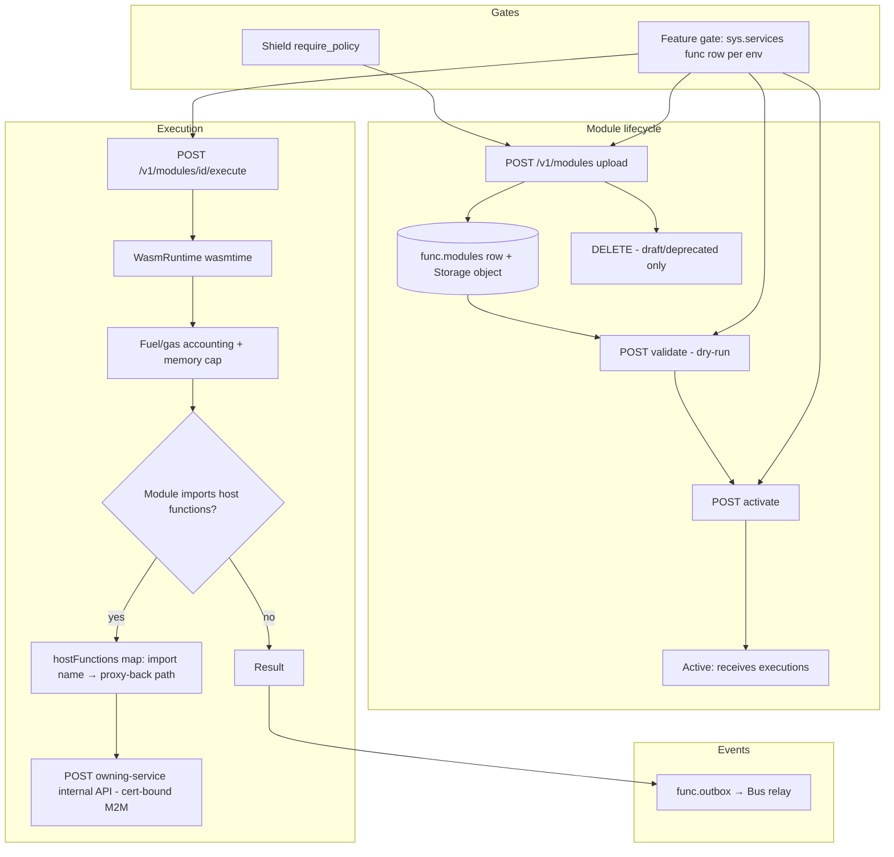

# Design Doc: Sentin8:Func - Standalone WASM Execution Service

## 1. Summary

Sentin8:Func is the platform's serverless WASM execution service.
Users-authored and service-authored modules (compiled to WebAssembly)
are uploaded, validated, activated, and executed per hook; execution is
gas-limited, host functions proxy back to the owning service's
internal API, and module results are deterministic and idempotent.
Sentin8:Flow steps and event triggers invoke it; the WASM engine can
be feature-gated per environment.

## 2. Motivation

- **User-defined logic without deployment.** Custom hooks, compliance
  rules, and tenant-authored functions are the one class of logic no
  platform service owns - a WASM host executes them with hard
  resource bounds (no interpreter escape, no arbitrary syscalls).
- **Event-triggered execution.** "Event first, API second": when a
  service needs a reaction no service owns, a trigger invokes a
  module. The payload-completeness rule applies - the hook receives a
  self-contained envelope.
- **Determinism + safety.** The same module + input must produce the
  same result (idempotency keys dedupe replays), and a malicious or
  buggy module cannot escape (linear memory only, fuel-based gas,
  no WASI filesystem/network).
- **Lifecycle discipline.** Modules move draft → active → deprecated;
  a broken binary can never receive traffic without passing
  validation and an explicit activation.

## 3. Architecture & High-Level Design

- **Upload** - the binary (base64 WASM), source language, exported
  hooks, parameters, and optional hash; the Storage object (keyed by
  module id) is written BEFORE the metadata row, with a best-effort
  rollback on metadata failure.
- **Execution** - the runtime instantiates the module, injects the
  hook request (JSON over linear memory), charges fuel per instruction,
  and enforces the memory ceiling; timeouts abort deterministically.
- **Feature gate** - `sys.services` (`service='func'`, per-env
  `enabled`); a missing row defaults to OPEN (platform default), an
  explicit disabled row closes the engine (409 on every mutating
  endpoint). The gate query is schema-qualified (`sys.services`) -
  the func role's `search_path` is `func, public`, so unqualified
  names fail.
- **Audit** - module lifecycle and executions emit through the local
  outbox; hook names are validated against the known set at upload.

## 4. Key Traits and Data Structures

- **`WasmRuntime`** - the wasmtime wrapper: engine config (fuel,
  memory ceiling, epoch deadline), module cache, and the
  host-function binder.
- **`UploadRequest` / `ExecuteRequest` / `ExecuteResponse`** - the
  module contract: binary + language + hooks + parameters; execution
  carries hook name + context + optional callback config; the
  response carries the hook result (and directives in hook-protocol
  mode).
- **`ModuleRecord`** - the stored module: id, domain, product,
  version label, status, storage key, hooks, parameters.
- **Hook protocol** - request/response serde types (`HookRequest`,
  `HookResponse` with `accept`/`reject` + `reject_reason` +
  directives) - the contract tenant-authored functions implement.

## 5. Rationale, Trade-offs, and Alternatives

- **WASM over interpreted DSLs or containers.** Containers give
  arbitrary code execution (needs a full sandbox host); DSLs need a
  parser, sandbox, and versioning surface. WASM gives byte-code-level
  isolation with platform-standard toolchains (Rust/TS compile to it).
- **Fuel (gas) limiting.** CPU is bounded per instruction; a
  non-terminating module dies deterministically. A wall-clock-only
  cap would allow bursty memory allocation; both bounds together
  close the practical DoS window.
- **No WASI preopened fs/socket.** Modules cannot touch the host
  network or filesystem - data access is exclusively via declared
  host functions that proxy-back. The runtime is generic (no
  pre-registered service-specific hosts; the caller supplies the
  import → path map per execute).
- **Proxy-back for host functions.** The module's import names map to
  the owning service's internal API; Func stays stateless regarding
  domain data. Alternative (Func reads domain DBs) breaks the
  persistence-plane rule.
- **Two-phase promotion (validate → activate).** Validation dry-runs
  the module (compile + smoke-execute) without publishing; activation
  is the explicit promotion. A single-step upload would route traffic
  to unverified binaries.
- **Storage before metadata.** The object write precedes the row; a
  metadata failure rolls back the object best-effort. The inverse
  order would leave rows pointing at missing objects.
- **Feature gate defaults OPEN.** A missing `sys.services` row means
  the platform default (enabled); an explicit row closes it. The
  gate must not fail closed on a fresh env simply because nobody
  seeded a row - that would break the zero-config vertical enroll.
- **Status-based deletion restriction.** Only draft/deprecated modules
  delete; an active module must be deprecated first (no traffic
  teardown while serving).
- **Rejected: per-service WASM runtimes.** Each service would re-roll
  fuel/memory/gas accounting and module storage; the standalone host
  centralizes safety knobs and observability.
- **Rejected: JS V8 isolates.** Heavier runtime, weaker
  determinism guarantees, and a larger TCB for untrusted code.

## 6. Internal Implementation & Invariants (Private Design)

- **Invariants:**
  - Modules execute with fuel + memory caps; a fuel-exhausted or
    timed-out execution aborts with a structured error (no partial
    commits).
  - Every execution carries an idempotency key; replays return the
    recorded result within the dedupe window.
  - The module's hooks must be from the known hook set; undeclared
    hook executions are rejected.
  - All DB writes run with the tenant context set on the same
    connection inside the explicit transaction (transaction-local
    RLS); the gate query reads `sys.services` qualified (the role's
    search_path is `func, public`).
  - Non-2xx callback results fail the execution (the host function's
    error propagates); failures retry with backoff and land in the
    DLQ - never silently dropped.
  - Upload is atomic: object-before-row; metadata failure triggers
    best-effort object rollback.
  - Only the module owner (or admin) may upload/activate/delete;
    Shield decides (no handler scope checks).
- **Boot (shell-owned).** The shell owns the listener stack; Func
  builds its capped pool + PG18 check, consumes the Shield engine,
  wires the Storage client (M2M), and mounts the module API + admin
  UI.
- **Runtime.** Modules are compiled per activation and cached;
  execution uses epoch-based interruption so long-running modules
  yield; host-function marshalling is JSON-over-linear-memory.

## 7. Unresolved Questions / Future Designs

- Module versioning is content-addressed (`wasm_hash` verified server-side;
  identical re-uploads re-register the existing version) with the
  active-version pointer per (domain, product). Execution addresses a
  module by pinned id (`POST /v1/modules/{id}/execute`) or by product's
  active version (`POST /v1/modules/product/{product_id}/execute`); per-hook
  traffic splitting between versions is a future design.
- WASI preview 2 is tracked upstream (`wasmtime` preview-2 support); adopt
  when the proxy-back host interface needs it.
- Per-tenant gas pricing emits execution duration + fuel per invocation as
  metrics (family `func`).
- Module signing signs module blobs at upload (publisher key stored as a
  secrets reference).

---

**Architecture & Design:** sentin8:func and its underlying concepts were designed by [Hamid Jahanzad](https://www.linkedin.com/in/hamidjahanzad/).
